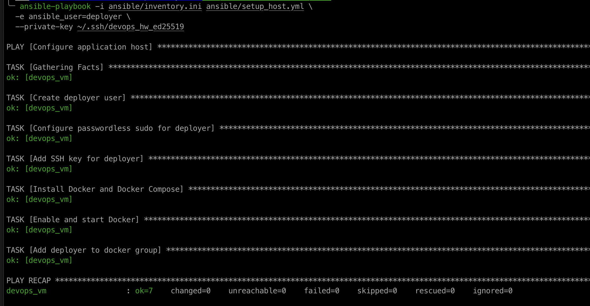
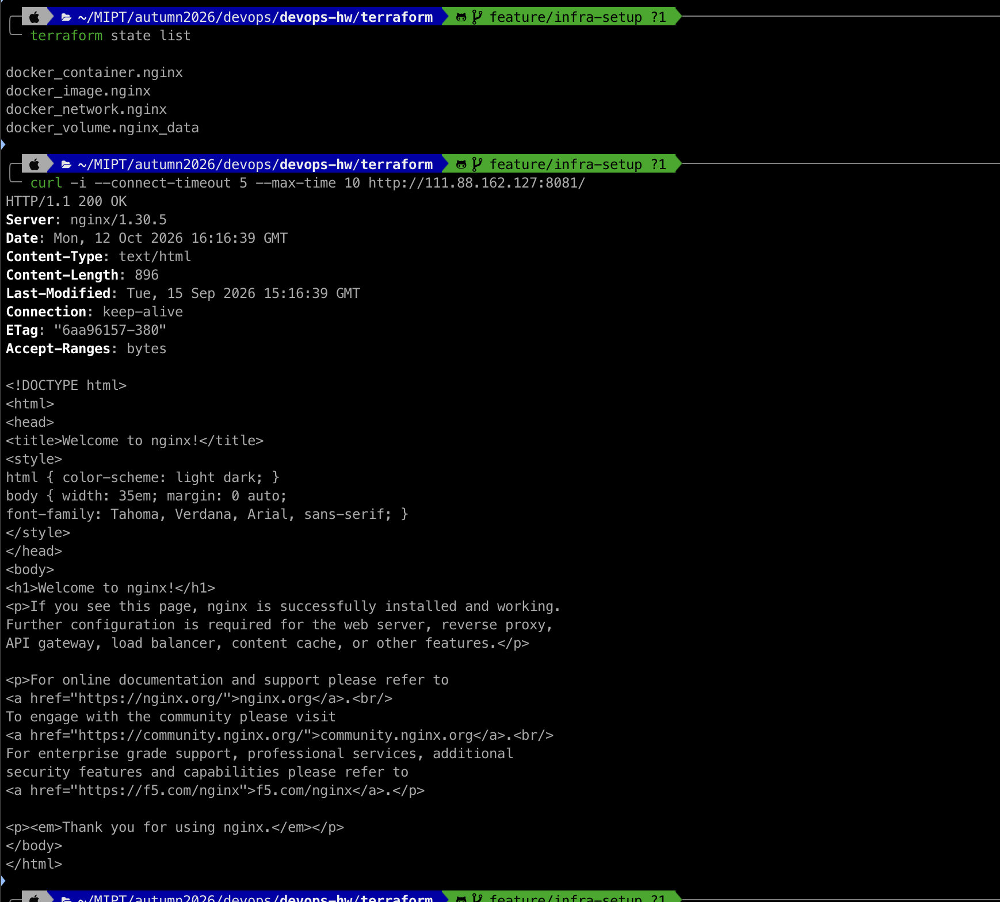
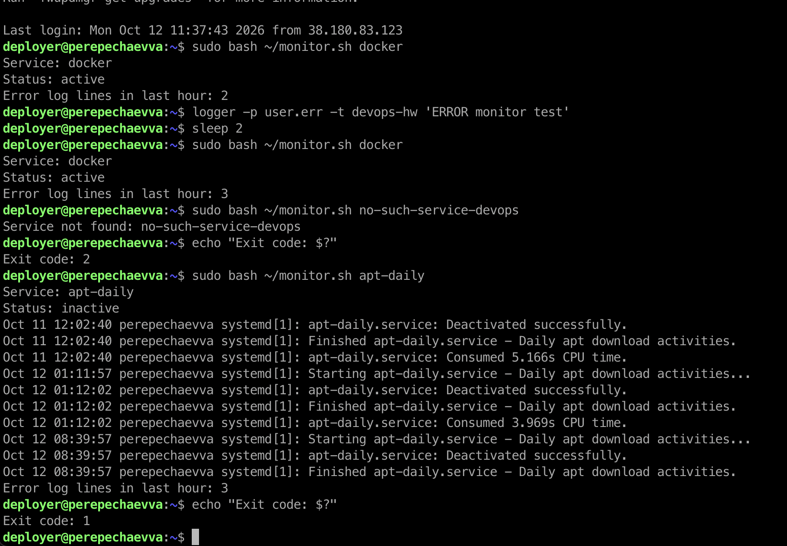
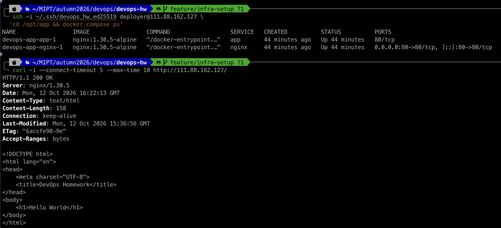

# DevOps Homework

Ubuntu 24.04 VM: `111.88.162.127`.

По уточнению преподавателя этап 2 с VM/VPC/Security Group/IAM
заменён созданием Docker-контейнера через Terraform.
Ansible выполняется перед Terraform.

## Архитектура

- Ansible: пользователь deployer, SSH-ключ, sudo, Docker и Compose.
- Terraform: nginx на порту 8081, сеть tf-network, том tf-nginx-data.
- Compose: nginx-прокси на порту 80 → app со страницей Hello World,
  оба в отдельной сети app-network.
- Bash: проверка сервиса и подсчёт строк с ошибками за последний час.

Разные сети и порты разделяют Terraform-упражнение и приложение.
Версии образов и провайдера закреплены. Terraform state и приватные
ключи исключены из Git.

## Подготовка

Команды выполняются на Mac из корня репозитория.
Нужны Homebrew, SSH-доступ student к VM с sudo и ключ
`~/.ssh/devops_hw_ed25519` с соответствующим `.pub` файлом.

```bash
brew install ansible
brew tap hashicorp/tap
brew install hashicorp/tap/terraform
ssh-add ~/.ssh/devops_hw_ed25519
```

## Ansible

Первичная настройка:

```bash
ansible-playbook -i ansible/inventory.ini ansible/setup_host.yml --ask-pass
```

Повторный запуск должен показать `changed=0`:

```bash
ansible-playbook -i ansible/inventory.ini ansible/setup_host.yml \
  -e ansible_user=deployer \
  --private-key ~/.ssh/devops_hw_ed25519
```



## Terraform

```bash
cd terraform
terraform init
terraform validate
terraform plan
terraform apply
terraform state list
curl -i http://111.88.162.127:8081/
cd ..
```

Ожидается `200 OK`.



## Мониторинг

```bash
bash -n scripts/monitor.sh

scp -i ~/.ssh/devops_hw_ed25519 scripts/monitor.sh \
  deployer@111.88.162.127:~/monitor.sh

ssh -i ~/.ssh/devops_hw_ed25519 deployer@111.88.162.127 \
  'sudo bash ~/monitor.sh docker'
```

Скрипт использует systemctl, journalctl, grep и awk.
Для неактивного сервиса выводит последние 10 записей журнала.

Коды: 0 — активен, 1 — неактивен, 2 — ошибка или неизвестный сервис.
Пустой syslog даёт счётчик 0. Недоступный syslog вызывает ошибку.

На Mac проверяется синтаксис, функциональные проверки выполнены на VM.
Скрипт рассчитан на ISO-даты UTC в текущем `/var/log/syslog`.
Ошибки определяются по словам error, failed, failure, fatal.



## Docker Compose

```bash
ssh -i ~/.ssh/devops_hw_ed25519 deployer@111.88.162.127 \
  'sudo install -d -o deployer -g deployer -m 0755 /opt/app'

scp -i ~/.ssh/devops_hw_ed25519 -r compose/. \
  deployer@111.88.162.127:/opt/app/

ssh -i ~/.ssh/devops_hw_ed25519 deployer@111.88.162.127 \
  'cd /opt/app && docker compose config --quiet && docker compose up -d && docker compose ps'

curl -i http://111.88.162.127/
```

Ожидается `200 OK` и `Hello World`.


